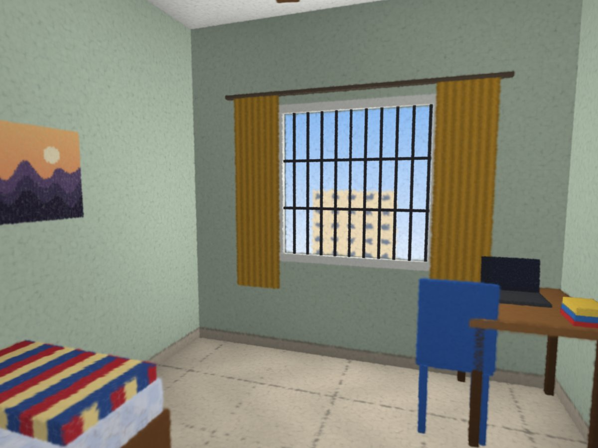

# RoomWalk

Walk through a rental room on your phone before you pay the deposit.

Someone living in the room films it for a minute. RoomWalk checks the video, rebuilds the room in 3D as a Gaussian splat, and publishes it as a link that opens in a phone browser with no app. A signed one-time code filmed at the start of the video shows the footage is recent.

Students and interns moving to a new city rent rooms they have never seen. Fake PG listings use attractive photos, avoid video calls and ask for an advance to "hold" the room. A walkable 3D scan filmed against a fresh code is much harder to fake than a photo, and lets the renter look at what photos leave out: the corners, the floor, the window bars, the damp patch by the door.



## Pipeline

```
phone video ─► capture check ─► frame selection ─► structure from motion ─► alignment ─► training ─► packing ─► web viewer
 + QR code      blur, light,     sharpest frame     COLMAP via pycolmap      gravity,      Brush      SOG and      Next.js, three.js,
                detail, motion,  per time window    (camera poses and        scale and     (GPU)      chunked RAD  Spark; on-demand
                coverage, code                      sparse points)           start view                            rendering
```

| Folder | What lives there |
| --- | --- |
| `capture/` | Python package and `roomwalk` command: checks, frame selection, SfM, alignment, training, packing, publishing |
| `web/` | Next.js static site: listing page, room viewer, benchmark and smoke-test scripts |
| `docs/SCAN_GUIDE.md` | Filming a real room and publishing it, step by step |
| `docs/HOW_IT_WORKS.md` | How reconstruction, sorting and streaming work, in plain words |

## Measured Results

All numbers below come from scripts in this repo and can be rerun.

**Capture checks** (`pytest capture/tests`). Synthetic videos with known problems: blurry stretches, darkness, blank walls, partial loops, valid and invalid freshness codes. Every case is classified correctly, and a known 380 degree pan reads back as 379 degrees.

**Reconstruction and alignment** (`pytest -m slow capture/tests/test_e2e_sfm.py`). A video of a walk through a textured box room along a known path, with a freshness code at the start, run through check, frame selection, COLMAP and alignment. Training is skipped because it needs a GPU.

| Measure | Result |
| --- | --- |
| Freshness code | Verified |
| Frames placed by structure from motion | 79 of 79 |
| Gravity error after alignment | 0.01 degrees |
| Scale error (metres recovered from eye height alone) | 0.5% |
| Camera height error | 1 mm |

Getting there took three fixes that the test forced, each written up in [docs/HOW_IT_WORKS.md](docs/HOW_IT_WORKS.md). The first floor detector made the room 1.9 times too big when the floor was barely in view. Averaging camera up vectors tilted gravity whenever the phone looked down more at some walls than others (11 degrees in a unit test). The fixes were gravity from the phone's right edge, which pitch cannot move, and a floor found as a peak in the height histogram that spans the room.

**Delivery** (`npm run bench`). Time from opening the link until the room is visibly on screen, median of 3 runs, for the 396k-splat demo room. Bandwidth is capped at the server and shared across connections; "good" is 20 Mbit/s with 40 ms latency, "congested" is 4 Mbit/s with 150 ms.

| Network | Format | First view | Room data before first view | Room data after 8 s |
| --- | --- | --- | --- | --- |
| 4G, good signal | SOG | 13.8 s | 2.6 MB | 2.6 MB |
| 4G, good signal | RAD | 3.9 s | 4.1 MB | 10.4 MB |
| 4G, congested | SOG | 23.2 s | 2.6 MB | 2.6 MB |
| 4G, congested | RAD | 12.9 s | 1.4 MB | 7.0 MB |

Streaming shows the room 3.5 times sooner on a good connection and 1.8 times sooner on a congested one, at the cost of more data overall. These were measured with software WebGL on a 2-core cloud machine, which inflates decode and render time for both formats, so they compare the formats fairly but are not phone numbers. Phone measurements go in `docs/phone-results.md`.

The same run shows where the next win is: 3.7 MB of JavaScript, mostly Spark with its WebAssembly inlined, served uncompressed by the benchmark server. Real hosts compress it, but it still has to download before anything else happens.

**Idle cost.** The viewer renders only when something changes. After the room settles, it draws 0 to 3 frames in 3 idle seconds instead of 180.

## Design Decisions

**Two delivery formats.** SOG is one small file (the demo is 2.4 MB, down from 26.9 MB as PLY), but the phone must download all of it and then build a level-of-detail tree before the room appears. RAD is Spark's precomputed tree, split into chunks with the coarse levels first, so the room appears after the first chunk. RAD is about 4x larger in total. The viewer uses RAD when it exists and SOG otherwise; `?format=sog|rad` forces one.

**Check before training.** A bad video still produces a 3D room, just a bad one, and you only find out after half an hour of training. The capture check takes under a minute and says what to change. Its warnings are also shown to renters as "known gaps", so a smeared corner reads as a scanning limit rather than a hidden defect.

**Alignment from camera poses.** Structure from motion has no gravity and no units. The pipeline recovers up as the direction perpendicular to every camera's right edge, metric scale from camera height above the floor, and the start view from the first frame, so a scan opens level, life-size and facing the way the video began. When the floor was never filmed it falls back to the ceiling, then to a typical room size, and says so.

**Adaptive quality.** Each phone starts at a tier picked from its GPU, cores and memory. While you move, the viewer lowers pixel ratio and then splat budget below 26 fps, and raises them back above 52 fps, with hysteresis so it doesn't flicker.

**What the code proves.** The stamp means the video was filmed within 48 hours of the code being issued, by someone it was sent to. It does not prove the address, and the site says so.

## Run It

### See the demo room

```bash
cd web
npm install
npm run build
npm start          # http://localhost:3000
```

Open `http://<your-laptop-ip>:3000` on a phone on the same Wi-Fi. Add `?stats=1` to a room link for live performance numbers.

### Publish a real room

```bash
cd capture
pip install -e ".[sfm,plot,dev]"
roomwalk code my-room                      # QR code to film first
roomwalk check my-room.mp4 --room my-room  # under a minute
roomwalk build my-room.mp4 --room my-room --title "Single room, 2nd floor" --rent 9500
```

Training needs [Brush](https://github.com/ArthurBrussee/brush) and a GPU. The full walkthrough, including Windows setup and filming instructions, is in [docs/SCAN_GUIDE.md](docs/SCAN_GUIDE.md).

### Tests and benchmarks

```bash
cd capture && pytest -m "not slow"           # capture checks, alignment, freshness codes
cd capture && pytest -m slow -s              # video to aligned room through COLMAP
cd web && npm run smoke                      # headless browser: rooms render, hotspots move
cd web && npm run bench -- demo --runs 3     # first view and data use per format
```

## Limitations and Next Steps

- No real room has been scanned yet; the first one is planned. The demo room is synthetic and labelled as such.
- Codes are issued and checked on one machine. A real service would issue them from a server, take uploads from the tenant's phone and run the pipeline on a GPU worker.
- Device tiers match GPU names with a pattern; real measurements across budget Android phones should replace the guesses.
- Mirrors, glass and blank walls reconstruct poorly. The capture check warns about blank walls but cannot detect mirrors.
- The JavaScript bundle is large because Spark inlines its WebAssembly. Loading Spark after showing the poster, and serving the WebAssembly as a separate cached file, should cut time to first view on slow networks.

## Built With

[Spark](https://github.com/sparkjsdev/spark) (MIT) for rendering and level of detail, [three.js](https://threejs.org) (MIT), [Next.js](https://nextjs.org) (MIT), [PlayCanvas splat-transform](https://github.com/playcanvas/splat-transform) (MIT) for cleaning and SOG, [Brush](https://github.com/ArthurBrussee/brush) (Apache 2.0) for training, [COLMAP](https://colmap.github.io) and pycolmap (BSD) for structure from motion, and OpenCV.

MIT licensed. By Arjun V. Arun.
